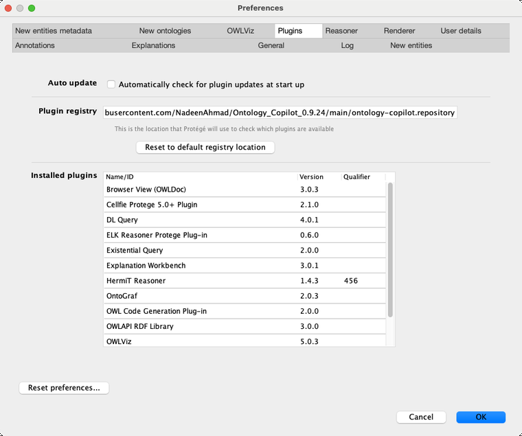
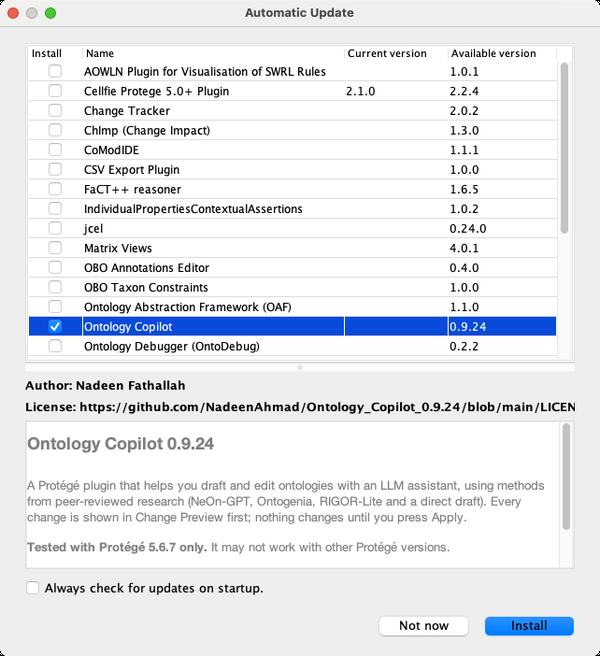
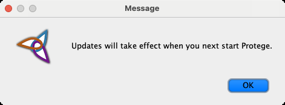
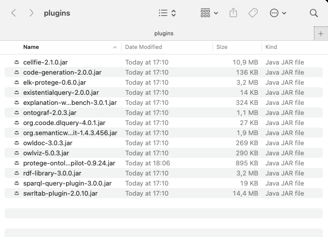
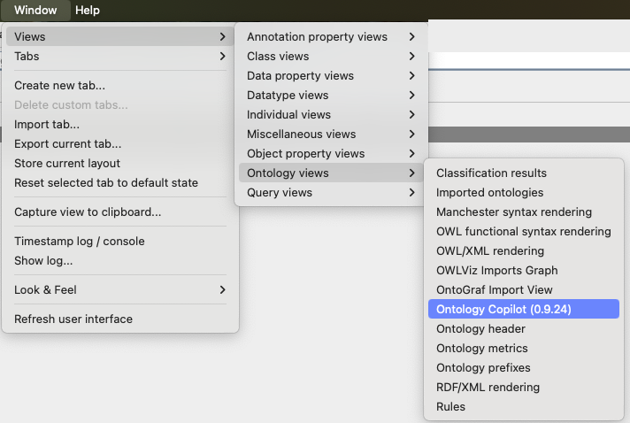
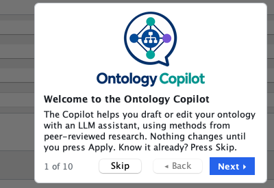
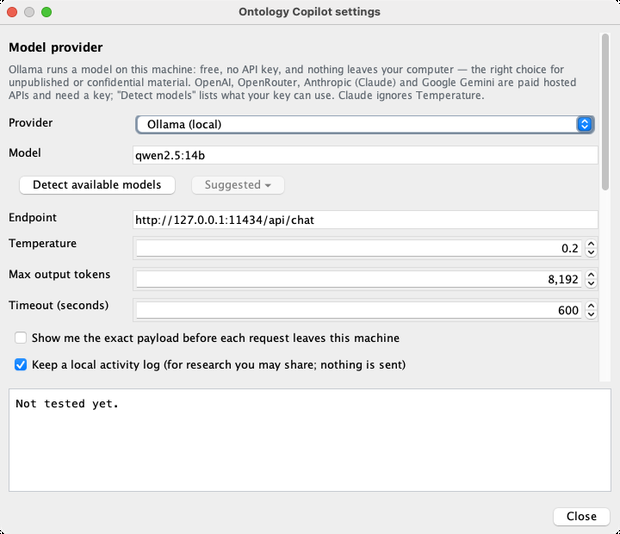

<div align="center">
  <picture>
    <source media="(prefers-color-scheme: dark)" srcset="images/logo-dark.png">
    
  </picture>
</div>

# Ontology Copilot 0.9.24

A plugin for [Protégé](https://protege.stanford.edu) that helps you draft and edit ontologies with an LLM assistant,
using methods from peer-reviewed research (NeOn-GPT, Ontogenia, RIGOR-Lite and a direct draft). Every change is shown
in Change Preview first; nothing changes in your ontology until you press Apply.

## Install

> **Tested with Protégé 5.6.7 on macOS only.** It may not work with other Protégé versions.

There are two ways. Option 1 needs no files or folders; if it doesn't work for you, use Option 2.

### Option 1: Protégé's plugin installer

1. In Protégé, open the preferences (macOS: **Protégé ▸ Settings…**; Windows / Linux: **File ▸ Preferences…**) and go
   to the **Plugins** tab. In **Plugin registry**, paste

   ```
   https://raw.githubusercontent.com/NadeenAhmad/Ontology_Copilot_0.9.24/main/ontology-copilot.repository
   ```

   and click **OK**. Protégé's standard plugins stay in the list.

   

2. Choose **File ▸ Check for plugins…**, tick **Ontology Copilot** and click **Install**.

   

3. Protégé says the plugin takes effect at the next start. Click **OK** and restart Protégé.

   

Protégé saves plugins installed this way in your user folder (`~/.Protege/plugins`). If you installed an older version
by hand (Option 2), delete that copy from Protégé's `plugins` folder first, so Protégé doesn't find two.

### Option 2: by hand

1. Download [`protege-ontology-copilot-0.9.24.jar`](protege-ontology-copilot-0.9.24.jar).
2. Quit Protégé and copy the file into Protégé's `plugins` folder:
   - macOS: right-click Protégé.app ▸ **Show Package Contents** ▸ `Contents` ▸ `plugins`;
   - Windows / Linux: the `plugins` folder inside the Protégé folder.

   Delete any older `protege-ontology-copilot-…jar` there.

   

3. Start Protégé.

## First start

1. Open or create an ontology, then choose **Window ▸ Views ▸ Ontology views ▸ Ontology Copilot (0.9.24)** and click
   where the view should go.

   

2. A short guided tour starts the first time. Skip it, or click through its 10 steps; the **Quickstart** button starts
   it again.

   

3. Open the side panel with **◂** on the right, click **Settings…**, choose a **Provider** (OpenRouter, OpenAI,
   Anthropic, Google Gemini or a local Ollama) and a **Model**, paste your API key further down and click
   **Use for this session only** (or **Save to Keychain** on macOS), then **Test connection**. Ollama needs no key.

   

## Your data

- Your API key stays on your computer: in the macOS Keychain, or only for the current session.
- The plugin keeps a local activity log of what you do in it (`Documents/OntologyCopilot/activity`). It is never sent
  anywhere, and you can switch it off in Settings.

## In this repository

- `protege-ontology-copilot-0.9.24.jar`: the plugin.
- `update.properties`, `ontology-copilot.repository`, `readme.html`: what Protégé's plugin installer reads.
- `images/`: the logos and screenshots used here.

## Licence

MIT, see [LICENSE](LICENSE).
